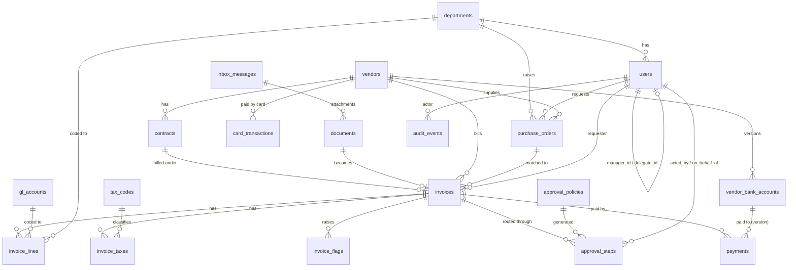

# Data model

**Status:** Proposed — confirm at kickoff, then the schema owner turns it into the first migration.
**Code as of:** never.

Three groups: **reference data** seeded from the dataset, **the pipeline** our app writes, and
**the audit log**. Historical invoices go into the *same* `invoices` tables as new ones
(`source = 'historical'`, status `Paid`), so coding history and duplicate search are one query.

## Tables that need explaining

| Table | Key columns | Why it is shaped this way |
|---|---|---|
| `users` | `role` (`employee`/`ap_clerk`/`approver`/`finance_manager`/`controller_admin`/`auditor`), `department_id`, `manager_id`, `approval_limit_cents`, `work_province`, `status` (`active`/`on_leave`/`terminated`), `delegate_id` | delegation and escalation are data, not code. The terminated employee is kept so old records resolve, and is never routed to. |
| `vendors` | `status`, `requires_po`, `accepts_card_payment`, `preferred_payment_method`, `ap_contact_email`, `default_gl_account` | `requires_po` drives policy P13; the contact email's domain is what lookalike senders are compared to. Bank columns from the CSV seed the first `vendor_bank_accounts` row. |
| `contracts` | `billing_type`, `monthly_fee_cents`, `hourly_rate_cap`, `fuel_surcharge_cap_pct`, `not_to_exceed_monthly_cents`, `start_date`, `end_date`, `status` | caps are per contract, not per item: validation checks hourly rate, fuel surcharge %, monthly fee and the monthly not-to-exceed (summed over the vendor's invoices that month). |
| `purchase_orders` | `total_amount_cents`, `status`, `approved_by` | **remaining balance** = total − invoices already matched to it (policy P12); computed, not stored. |
| `vendor_bank_accounts` | `vendor_id`, `version`, `status` (`pending`/`verified`/`rejected`/`superseded`), `requested_by`, `verified_by` | a bank change is a **new row**, never an update. Payments reference the row they paid to. Only `verified` rows are payable. |
| `documents` | `storage_key`, `sha256`, `mime`, `inbox_message_id` | the PDF lives once; sha256 catches byte-identical resubmissions for free. |
| `invoices` | `status`, `version`, `vendor_id` (nullable until matched), `vendor_name_raw`, `invoice_number`, `invoice_number_norm`, `invoice_date`, `currency`, `total_cents`, `total_cad_cents`, `fx_rate`, `ship_to_province`, `is_credit_note`, `po_id`, `requester_id`, `extraction_raw jsonb`, `extraction_confidence`, `source` | `version` bumps on a material edit, which voids approvals tied to the old version. `invoice_number_norm` (upper, no spaces or dashes) is what duplicate search indexes. |
| `invoice_lines` | `line_type` (`goods`/`services`), `qty`, `unit_price_cents`, `amount_cents`, `gl_account_code`, `department_id`, `coding_source` (`suggested`/`accepted`/`changed`), `coding_reason jsonb` | the suggestion and what the person chose are both kept, so we can show accuracy. |
| `invoice_taxes` | `tax_code`, `base_cents`, `rate`, `amount_cents` | one row per tax line (GST and PST are two rows), mapped to the provided codes. |
| `invoice_flags` | `code`, `severity` (`block`/`warn`/`info`), `message`, `evidence jsonb`, `related_invoice_id`, `related_card_txn_id`, `status` (`open`/`resolved`/`overridden`), `resolved_by`, `resolution_note` | validation **and** duplicates write here; `block` flags stop submit. Overriding needs a note. |
| `approval_steps` | `invoice_id`, `invoice_version`, `seq`, `policy_id`, `assigned_to`, `acted_by`, `on_behalf_of`, `decision`, `comment`, `decided_at` | `acted_by` + `on_behalf_of` is how a delegate action is recorded. Steps for an old `invoice_version` are void. |
| `approval_policies` | `priority`, `conditions jsonb`, `steps jsonb`, `active`, `version` | admin-editable without a deploy; the policy version is kept on each step. |
| `payments` | `invoice_id`, `bank_account_id`, `amount_cents`, `amount_cad_cents`, `status` (`scheduled`/`released`/`settled`/`failed`/`cancelled`), `prepared_by`, `released_by` | its own lifecycle; the invoice becomes `Paid` when payments settle. |
| `audit_events` | `occurred_at`, `actor_id`, `on_behalf_of`, `action`, `entity_type`, `entity_id`, `invoice_id`, `before jsonb`, `after jsonb`, `reason` | append-only: the app's database role has no `UPDATE`/`DELETE` on it. |

Seeded from `brim_ap_dataset/brim_ap_dataset/`: `departments`, `users`, `gl_accounts`,
`tax_codes`, `vendors` (+ first bank account row), `bank_change_history` → `vendor_bank_accounts`
versions, `contracts`, `purchase_orders` (no PO lines in the dataset), `fx_rates`,
`card_transactions`, `approval_policies` (P01–P13), `inbox/emails.json` → `inbox_messages`,
historical `invoices` + `invoice_lines` + `approvals` → `approval_steps` + `payments`, and
`bank_statement_lines` (only for the reconciliation bonus). The historical CSV keeps tax as
`gst_hst_amount` / `pst_qst_amount` per invoice and codes per line; the seed turns those into
`invoice_taxes` rows so history and new invoices look the same.

## Constraints worth enforcing in the database, not just in code

- `UNIQUE (vendor_id, invoice_number_norm) WHERE status NOT IN ('Voided')` — the last line of
  defence against an exact duplicate, even if a code path skips the check.
- `CHECK (released_by IS DISTINCT FROM prepared_by)` on payments is cheap; the full
  "not an approver of this invoice" rule needs a join, so it lives in `authorize()`.
- At most one `verified` and not `superseded` bank account per vendor (partial unique index).
